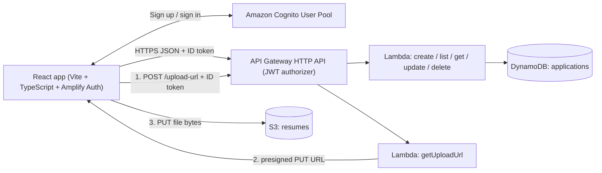

# Job Application Tracker (Serverless)

A full-stack app to track your job applications: company, role, status
(wishlist / applied / interview / offer / rejected), notes, and resume
uploads. Built to learn the AWS serverless stack end to end.

## Screenshots

Coming soon - dashboard and applications views, added once the frontend is deployed.

## Architecture



- **Frontend**: React + TypeScript + AWS Amplify Auth, built with Vite.
- **Authentication**: Amazon Cognito email sign-up/sign-in. API Gateway validates the Cognito JWT on every route.
- **API**: AWS API Gateway (HTTP API) fronting six Lambda functions (Node.js 20, TypeScript).
- **Database**: DynamoDB keyed by application `id`, with a `userId` + `createdAt` index for owner-scoped queries.
- **File storage**: Private S3. Resumes upload directly from the browser with a user-prefixed presigned URL.
- **Infrastructure as code**: AWS SAM (`backend/template.yaml`).
- **CI**: GitHub Actions runs backend typecheck + Jest tests + SAM lint, and a frontend build, on every push.

## Project layout

```
backend/            SAM template + Lambda handlers + Jest tests
  src/handlers/     one file per endpoint
  src/lib/          shared DynamoDB client, response helpers, validation
  tests/            Jest unit tests (AWS SDK mocked)
frontend/           React app
.github/workflows/  CI
LEARNING_GUIDE.md   deep-dive: how it all works + interview prep
```

## Prerequisites

- Node.js 20+
- An AWS account + AWS CLI configured (`aws configure`)
- AWS SAM CLI (`pip install aws-sam-cli`)

## Run the tests locally (no AWS needed)

```bash
cd backend
npm install
npm test        # backend unit tests; AWS SDK is mocked
```

## Deploy the backend

```bash
cd backend
npm install
sam build
sam deploy --guided   # first time: accept defaults, note the ApiUrl output
```

The deploy prints `ApiUrl`, `UserPoolId`, and `UserPoolClientId` outputs.

## Run the frontend

```bash
cd frontend
npm install
cp .env.example .env   # set API URL, Cognito User Pool ID and app client ID
npm run dev            # local dev server
npm run build          # production build into dist/
```

Create an account with an email address, enter Cognito's verification code,
then sign in. The frontend uses Amplify Auth to keep the session and sends the
ID token as `Authorization: Bearer ...` on each API request. Keep `.env` local;
it is ignored by Git.

To host the frontend, upload `dist/` to an S3 static website bucket or
any static host (Netlify, Vercel, GitHub Pages). Remember to rebuild
whenever `VITE_API_URL` changes: the value is baked in at build time.

## API

| Method | Path                | Purpose                          |
|--------|---------------------|----------------------------------|
| GET    | /applications       | list the signed-in user's applications |
| POST   | /applications       | create an application for the user |
| GET    | /applications/{id}  | get one of the user's applications |
| PUT    | /applications/{id}  | update an owned application |
| DELETE | /applications/{id}  | delete an owned application |
| POST   | /upload-url         | issue a user-prefixed presigned S3 PUT URL |

Every route requires a valid Cognito ID token. The backend takes `userId` from
the verified token's `sub` claim; it never trusts a user ID supplied in the
request body. List requests use the DynamoDB `UserIdCreatedAtIndex` GSI.

Example:

```bash
curl -X POST "$API_URL/applications" \
  -H "Authorization: Bearer $ID_TOKEN" \
  -H 'Content-Type: application/json' \
  -d '{"company":"Nike","role":"Software Engineer I, ITC","status":"APPLIED"}'
```

`ID_TOKEN` is the signed-in Cognito user's ID token; do not commit or log it.

## Known simplifications (and how to fix them)

- **Legacy records**: records created before Cognito have no `userId`, so they are not visible to signed-in users until explicitly migrated/assigned.
- **Query pagination**: listing uses a user-scoped Query but does not yet expose pagination for accounts with very large histories.
- **CORS `*`**: lock `AllowOrigins` down to your frontend domain in production.

## Cost

Everything sits inside the AWS free tier at personal scale (1M Lambda
requests, 25 GB DynamoDB, 5 GB S3 per month). Expect effectively $0 while
learning; delete the stack with `sam delete` when done.

## License

MIT
